<div align="center">

# Clean Architecture Template (.NET Aspire)

<a href="#solution-layout"></a>

<br/>

[](https://dotnet.microsoft.com/)
[](https://learn.microsoft.com/dotnet/csharp/)
[](https://learn.microsoft.com/dotnet/aspire/)
[](https://learn.microsoft.com/ef/core/)
[](https://www.postgresql.org/)
[](https://www.docker.com/)

[](https://opentelemetry.io/)
[](https://jwt.io/)
[](https://scalar.com/)
[](https://www.sonarsource.com/)
[](.github/workflows/build.yml)

[](https://xunit.net/)
[](https://testcontainers.com/)
[](.claude/skills/README.md)

**Author:** Ramazan Abdullah

</div>

A pragmatic Clean Architecture starter for **.NET 10**, orchestrated with **.NET Aspire 13.4**.
The Aspire AppHost starts PostgreSQL and the API together, and the Aspire dashboard shows logs,
traces, and metrics with no extra setup. The template comes with a working sample domain (Users +
Todos), JWT auth with refresh-token rotation, caching, rate limiting, and three kinds of tests.

---

## Table of contents

1. [Features at a glance](#features-at-a-glance)
2. [Quick start](#quick-start)
3. [Solution layout](#solution-layout)
4. [Architecture](#architecture)
   - [The dependency rule](#the-dependency-rule)
   - [Layers in detail](#layers-in-detail)
   - [Runtime topology (Aspire)](#runtime-topology-aspire)
   - [HTTP request pipeline](#http-request-pipeline)
   - [CQRS without MediatR](#cqrs-without-mediatr)
   - [Lifecycle of a command](#lifecycle-of-a-command)
   - [Result pattern and error mapping](#result-pattern-and-error-mapping)
   - [Domain events](#domain-events)
   - [Authentication and authorization](#authentication-and-authorization)
   - [Caching](#caching)
   - [Idempotency](#idempotency)
   - [Data model](#data-model)
   - [Observability](#observability)
5. [API reference](#api-reference)
6. [Configuration](#configuration)
   - [Web.Api settings](#webapi-settings)
   - [Aspire AppHost](#aspire-apphost)
   - [Launch profiles and ports](#launch-profiles-and-ports)
   - [Build settings](#build-settings-directorybuildprops)
   - [Central package management](#central-package-management-directorypackagesprops)
   - [Docker](#docker)
   - [CI/CD](#cicd)
7. [Database and migrations](#database-and-migrations)
8. [Testing](#testing)
9. [Extending the template](#extending-the-template)
10. [Author](#author)

---

## Features at a glance

| Area | What you get |
|---|---|
| **Orchestration** | Aspire AppHost starts a `postgres:17` container and the API, then opens the dashboard |
| **Architecture** | SharedKernel → Domain → Application → Infrastructure → Web.Api; the dependency rule is checked by tests |
| **CQRS** | Small `ICommand` / `IQuery` handlers with no MediatR; validation and logging run as Scrutor decorators |
| **Errors** | `Result` / `Result<T>` + `Error` instead of exceptions, mapped to RFC 7807 `ProblemDetails` |
| **Persistence** | EF Core 10 + Npgsql, snake_case naming, migrations applied automatically in Development |
| **Auth** | JWT bearer (HS256), PBKDF2-SHA512 password hashing, refresh tokens rotated on every use, permission policies |
| **Caching** | `HybridCache` (in-memory L1, optional distributed L2) with per-feature cache keys and invalidation |
| **API** | Minimal APIs discovered through `IEndpoint`, OpenAPI + Scalar UI with a JWT "Authorize" box |
| **Protection** | Fixed-window rate limiting (global + stricter auth policy), security headers, CORS, opt-in idempotency |
| **Observability** | OpenTelemetry logs, traces, and metrics (ASP.NET Core, HttpClient, EF Core, Npgsql, runtime) sent over OTLP |
| **Health** | `/health` (includes the PostgreSQL check) and `/alive` (liveness, Development only) |
| **Quality** | `TreatWarningsAsErrors`, `AnalysisMode=All`, SonarAnalyzer, `.editorconfig` code style enforced at build time |
| **Tests** | Architecture tests (NetArchTest), unit tests (EF InMemory + NSubstitute), integration tests (Testcontainers) |
| **AI tooling** | Claude Code skills in `.claude/skills/` that scaffold features, entities, tests, and migrations |

---

## Quick start

**Prerequisites**

- [.NET 10 SDK](https://dotnet.microsoft.com/download)
- Docker Desktop (or another OCI runtime) for the PostgreSQL container and for the integration tests

**Run everything**

```bash
dotnet run --project src/Aspire.AppHost
```

This command:

1. Starts the **Aspire dashboard** and opens it in your browser (`https://localhost:17168`).
2. Starts a **PostgreSQL 17** container. Its data lives in `.containers/db` at the repo root, so it survives restarts.
3. Waits until the database is healthy, then starts **Web.Api** with the connection string injected.
4. Applies EF Core migrations automatically (Development only).

Open the **Scalar API reference** from the `web-api` resource in the dashboard, or go to `https://localhost:5001/scalar/v1`.

**Try the API**

```http
POST /users/register   { "email": "me@example.com", "firstName": "Ramazan", "lastName": "Abdullah", "password": "Password123" }
POST /users/login      { "email": "me@example.com", "password": "Password123" }
# -> { "accessToken": "...", "refreshToken": "..." }
# Click "Authorize" in Scalar, paste the access token, then call the /todos endpoints.
```

**Build and test**

```bash
dotnet build CleanArchitecture.sln
dotnet test  CleanArchitecture.sln   # Docker must be running for the integration tests
```

---

## Solution layout

```text
CleanArchitecture.sln
├── Directory.Build.props          # Shared MSBuild settings: TFM, analyzers, author metadata
├── Directory.Packages.props       # Central NuGet package versions
├── .editorconfig                  # Code style, enforced at build time
├── .github/
│   ├── workflows/build.yml        # CI: restore → build → test → publish
│   └── dependabot.yml             # Daily NuGet update PRs
├── .claude/skills/                # Claude Code skills (add-feature, add-entity, ...)
├── src/
│   ├── Aspire.AppHost/            # Dev orchestrator: Postgres container + API + dashboard
│   ├── Aspire.ServiceDefaults/    # OpenTelemetry, health checks, service discovery, resilience
│   ├── SharedKernel/              # Result, Error, Entity, IDomainEvent, IDateTimeProvider
│   ├── Domain/                    # Entities, domain events, error catalogs
│   │   ├── Users/                 #   User, RefreshToken, UserErrors, UserRegisteredDomainEvent
│   │   └── Todos/                 #   TodoItem, Priority, TodoItemErrors, TodoItem*DomainEvent
│   ├── Application/               # Use cases (vertical slices) + abstractions
│   │   ├── Abstractions/          #   Messaging, Behaviors (decorators), Data, Auth, Pagination, Notifications
│   │   ├── Users/{Register,Login,Refresh,GetById,GetByEmail}/
│   │   └── Todos/{Create,Get,GetById,Update,Complete,Delete}/
│   ├── Infrastructure/            # EF Core, JWT, permissions, domain-event dispatch, email
│   │   ├── Database/              #   ApplicationDbContext, Schemas, Migrations/
│   │   ├── Authentication/        #   TokenProvider, PasswordHasher, UserContext
│   │   ├── Authorization/         #   Permission policy provider + handler
│   │   ├── DomainEvents/          #   DomainEventsDispatcher
│   │   ├── Users/, Todos/         #   IEntityTypeConfiguration<T> per entity
│   │   └── Notifications/, Time/
│   └── Web.Api/                   # Composition root + HTTP surface
│       ├── Endpoints/{Users,Todos}/   # One IEndpoint class per route
│       ├── Extensions/            #   DI/pipeline helpers, Result.Match, rate limiting, OpenAPI
│       ├── Infrastructure/        #   CustomResults, GlobalExceptionHandler, IdempotencyFilter
│       └── Middleware/            #   SecurityHeaders, RequestContextLogging
└── tests/
    ├── ArchitectureTests/         # Layer dependency rules (NetArchTest)
    ├── Application.UnitTests/     # Handler + validator tests
    └── IntegrationTests/          # Full HTTP tests against real Postgres (Testcontainers)
```

---

## Architecture

### The dependency rule

Source code dependencies **point inward only**. Inner layers do not know that outer layers exist.
Infrastructure details (EF Core, JWT, PostgreSQL) sit at the edge and are reached through
interfaces that the Application layer defines.

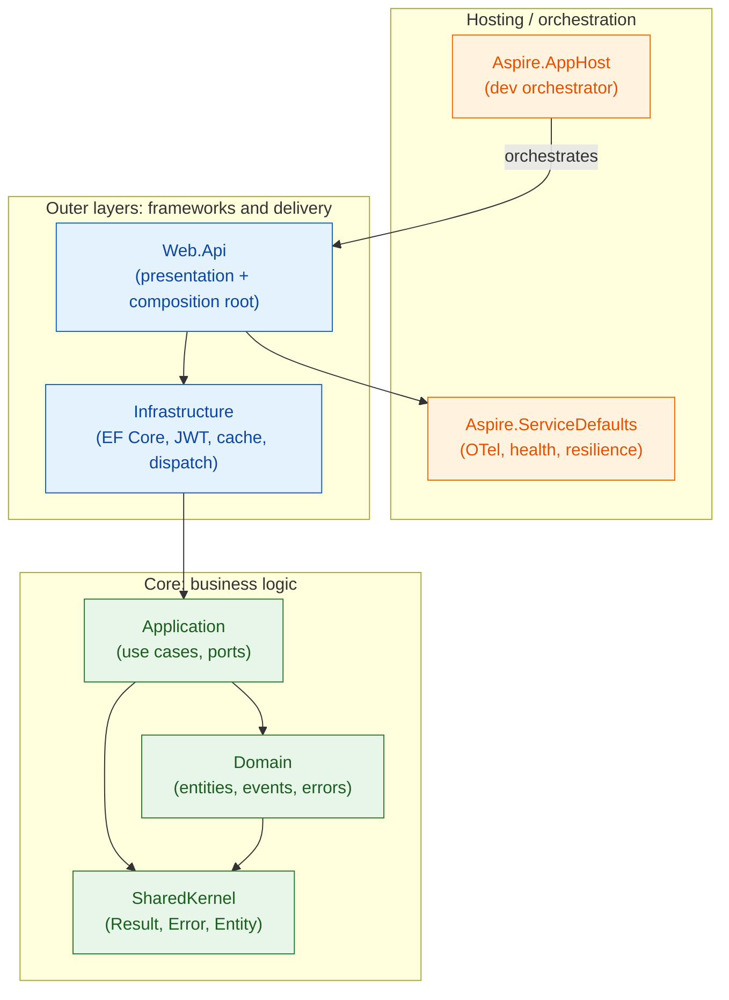

The same structure as concentric rings, where an arrow means "depends on":

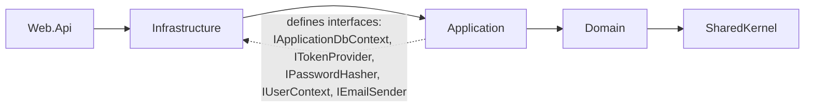

Application **owns the interfaces** (ports) and Infrastructure **implements** them (adapters). This is
dependency inversion: business logic never references EF Core's `ApplicationDbContext` or the JWT
library directly. The rule is enforced by `tests/ArchitectureTests/Layers/LayerTests.cs`, so a build
that breaks it fails CI.

### Layers in detail

| Layer | Responsibility | References | Key types |
|---|---|---|---|
| **SharedKernel** | Building blocks shared by every layer. No dependencies. | — | `Result`, `Result<T>`, `Error`, `ErrorType`, `ValidationError`, `Entity`, `IDomainEvent`, `IDomainEventHandler<T>`, `IDateTimeProvider` |
| **Domain** | Business entities, the events they raise, and catalogs of expected errors. No EF Core, no application types. | SharedKernel | `User`, `RefreshToken`, `TodoItem`, `Priority`, `UserErrors`, `TodoItemErrors`, `*DomainEvent` |
| **Application** | Use cases as **vertical slices** (`Todos/Create/`, `Users/Login/`, ...). Each slice holds its command or query, handler, validator, and response DTO. Defines the ports that Infrastructure implements. | Domain, SharedKernel | `ICommand`, `IQuery`, `ICommandHandler`, `IQueryHandler`, `ValidationDecorator`, `LoggingDecorator`, `IApplicationDbContext`, `PagedList<T>` |
| **Infrastructure** | Implements the ports: EF Core + PostgreSQL, JWT issuing and validation, password hashing, permission authorization, domain-event dispatch, HybridCache registration, email. | Application | `ApplicationDbContext`, `TokenProvider`, `PasswordHasher`, `UserContext`, `PermissionAuthorizationHandler`, `DomainEventsDispatcher`, `LoggingEmailSender` |
| **Web.Api** | HTTP delivery and **composition root**: wires DI, the middleware pipeline, endpoints, OpenAPI, rate limiting, CORS, and exception handling. Translates `Result` into HTTP responses. | Infrastructure, ServiceDefaults | `Program`, `IEndpoint`, `CustomResults`, `GlobalExceptionHandler`, `IdempotencyFilter`, middleware |
| **Aspire.ServiceDefaults** | Cross-cutting hosting defaults that any service can reuse. | — | `AddServiceDefaults()`, `MapDefaultEndpoints()` |
| **Aspire.AppHost** | Describes the local distributed app (resources and how they connect). Development only. | Web.Api (project reference) | `Program.cs` resource graph |

Inside Application, each feature folder is self-contained:

```text
Application/Todos/Create/
├── CreateTodoCommand.cs            # the request: ICommand<Guid>
├── CreateTodoCommandHandler.cs     # internal sealed, primary constructor
└── CreateTodoCommandValidator.cs   # FluentValidation AbstractValidator<CreateTodoCommand>
```

### Runtime topology (Aspire)

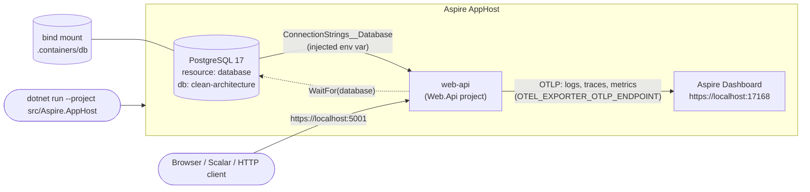

The whole graph is declared in [src/Aspire.AppHost/Program.cs](src/Aspire.AppHost/Program.cs):

```csharp
var database = builder.AddPostgres("database")
    .WithImage("postgres:17")
    .WithBindMount("../../.containers/db", "/var/lib/postgresql/data")
    .AddDatabase("clean-architecture");

builder.AddProject<Projects.Web_Api>("web-api")
    .WithEnvironment("ConnectionStrings__Database", database)
    .WithReference(database)
    .WaitFor(database);
```

### HTTP request pipeline

Middleware order as registered in [src/Web.Api/Program.cs](src/Web.Api/Program.cs):

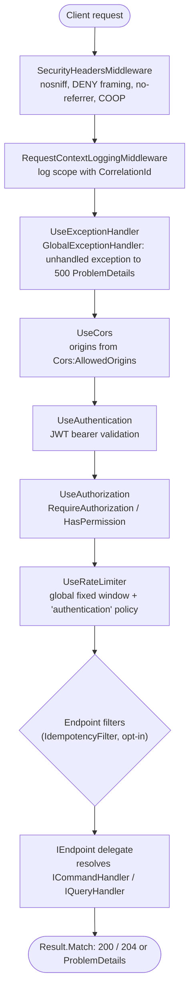

Endpoints are found by reflection: every non-abstract class that implements `IEndpoint` in the
Web.Api assembly is registered (`AddEndpoints`) and mapped (`MapEndpoints`). Adding a new route
means adding one class, with no central route table to update.

### CQRS without MediatR

Commands change state and queries read it. Each has its own small interface:

```csharp
public interface ICommand;                       // no return value  -> Result
public interface ICommand<TResponse>;            // returns a value  -> Result<TResponse>
public interface IQuery<TResponse>;              //                  -> Result<TResponse>

public interface ICommandHandler<in TCommand> where TCommand : ICommand
{ Task<Result> Handle(TCommand command, CancellationToken ct); }
```

Endpoints inject the **handler interface directly**, for example
`ICommandHandler<CreateTodoCommand, Guid>`. There is no mediator and no runtime dispatch lookup.
Scrutor scans the Application assembly, registers every handler as scoped, and **wraps it in
decorators**:

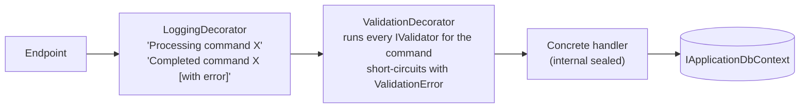

Decoration order in [src/Application/DependencyInjection.cs](src/Application/DependencyInjection.cs):
validation is registered first (innermost), then logging (outermost). Queries get logging only.
Validation runs only for commands.

### Lifecycle of a command

End-to-end trace of `POST /todos`:

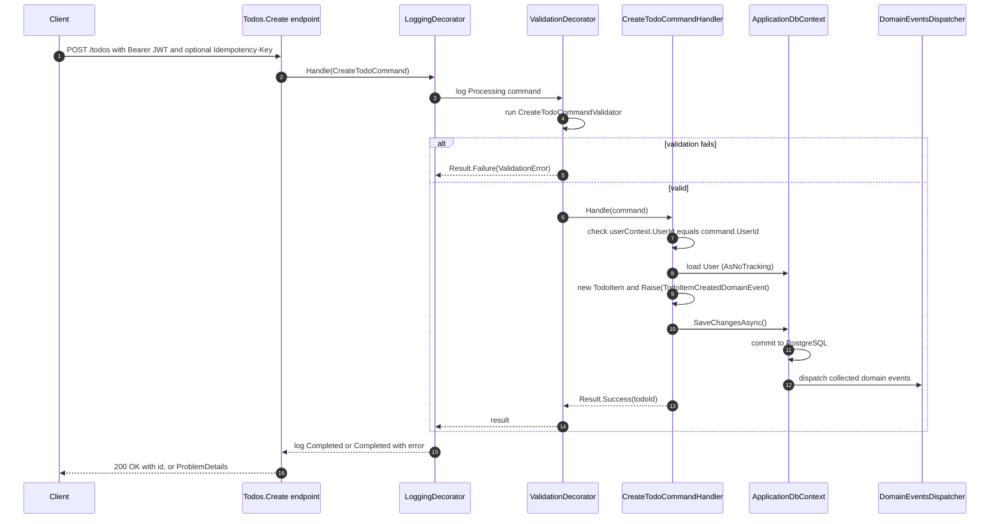

### Result pattern and error mapping

Expected failures (not found, conflict, validation) are **returned**, not thrown:

```csharp
if (todoItem is null)
    return Result.Failure(TodoItemErrors.NotFound(command.TodoItemId));
```

Error codes follow the pattern `"{FeaturePlural}.{Reason}"`, for example `TodoItems.NotFound` or
`Users.EmailNotUnique`. Endpoints translate the result with one line:

```csharp
return result.Match(Results.Ok, CustomResults.Problem);
```

`CustomResults.Problem` maps the `ErrorType` to an RFC 7807 response:

| `ErrorType` | HTTP status | `title` / `detail` | Example |
|---|---|---|---|
| `Validation` | **400** Bad Request | `Validation.General` + an `errors` array | invalid request body |
| `Problem` | **400** Bad Request | error code / description | `TodoItems.AlreadyCompleted`, `Users.InvalidRefreshToken` |
| `NotFound` | **404** Not Found | error code / description | `TodoItems.NotFound`, `Users.NotFound` |
| `Conflict` | **409** Conflict | error code / description | `Users.EmailNotUnique` |
| `Failure` | **500** Internal Server Error | "Server failure" (details hidden) | `Users.Unauthorized` |
| *unhandled exception* | **500** | "Server failure" via `GlobalExceptionHandler` | — |

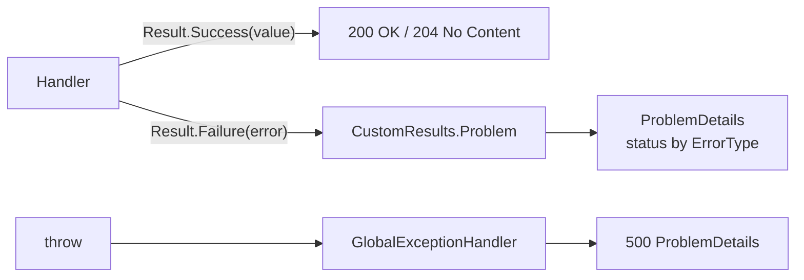

### Domain events

Entities derive from `SharedKernel.Entity` and call `Raise(new SomethingHappenedDomainEvent(...))`.
Events are published **after** the transaction commits (eventual consistency):

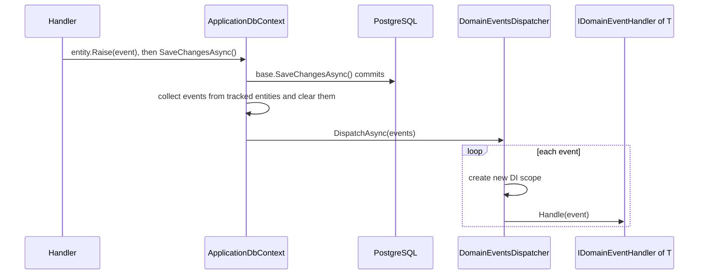

Example: `RegisterUserCommandHandler` raises `UserRegisteredDomainEvent`, and
`UserRegisteredDomainEventHandler` sends a welcome email through `IEmailSender`. The default
`LoggingEmailSender` only writes a log line; replace it with a real provider when you need one.

> **Trade-off:** events run after the commit, so a handler that fails does not roll back the
> original change. For guaranteed delivery, replace this with the Outbox pattern.

### Authentication and authorization

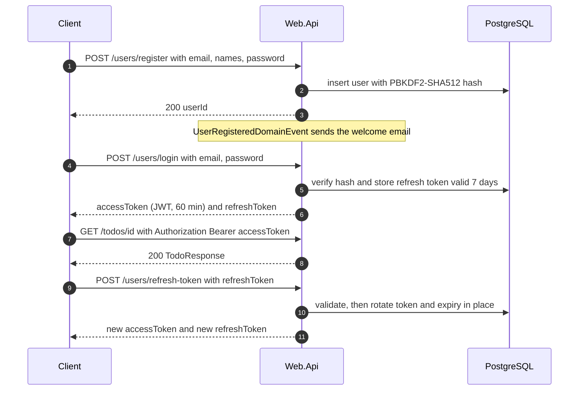

| Concern | Implementation |
|---|---|
| Password hashing | PBKDF2 with **SHA-512**, **500,000** iterations, 16-byte salt, 32-byte hash. Stored as `HASH-SALT` (hex). Compared in constant time (`CryptographicOperations.FixedTimeEquals`). |
| Access token | JWT signed with **HS256** using `Jwt:Secret`. Claims: `sub` (user id) and `email`. Lifetime: `Jwt:ExpirationInMinutes`. `ClockSkew = 0`. |
| Refresh token | 32 cryptographically random bytes (Base64), stored in `refresh_tokens` with a unique index. Valid for **7 days**. **Rotated on every refresh**, so a stolen token works only once. |
| Current user | `IUserContext.UserId` reads the `sub` / `NameIdentifier` claim from `HttpContext`. |
| Ownership | Handlers filter by `userContext.UserId`, or return `UserErrors.Unauthorized()` when the ids don't match. |
| Permissions | `.HasPermission("users:access")` creates a dynamic policy (`PermissionAuthorizationPolicyProvider`) that `PermissionAuthorizationHandler` evaluates. |
| Brute-force protection | `/users/register`, `/users/login`, and `/users/refresh-token` use the stricter `authentication` rate-limit policy. |

> **Before production:** `PermissionAuthorizationHandler` currently allows **any authenticated
> user** (see the `TODO`), and `PermissionProvider.GetForUserIdAsync` returns an empty set.
> Implement real permission lookup before relying on `.HasPermission(...)`.

### Caching

`HybridCache` is registered in Infrastructure. It provides an in-process L1 cache with stampede
protection and can add a distributed L2 cache (Redis, for example) without code changes.

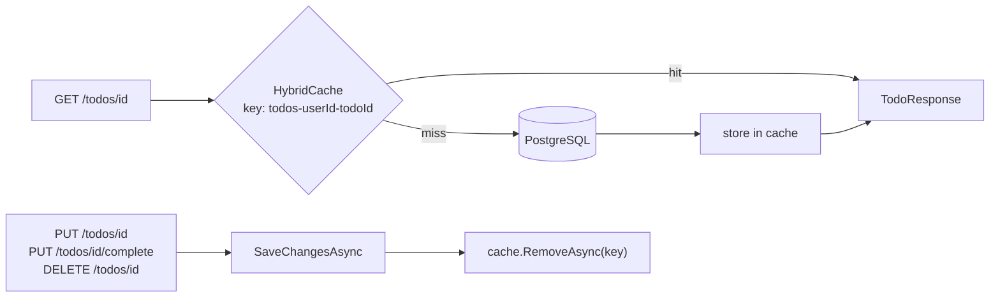

Keys are built by per-feature helpers (`TodoCacheKeys.ById(userId, todoId)`). Including the user id
in the key keeps one user's cache entries separate from another's.

### Idempotency

Add `.WithIdempotency()` to an endpoint (as `POST /todos` does) to enable duplicate detection. When a
request has an `Idempotency-Key` header, the first request with that key runs and the key is kept
for **1 hour** in HybridCache. A repeat with the same key returns **409 Conflict**. Requests without
the header run normally.

### Data model

PostgreSQL schema `public`, snake_case names (via `EFCore.NamingConventions`). Entities reference
each other through foreign-key ids. The only navigation property is `RefreshToken.User`, which the
refresh flow uses.

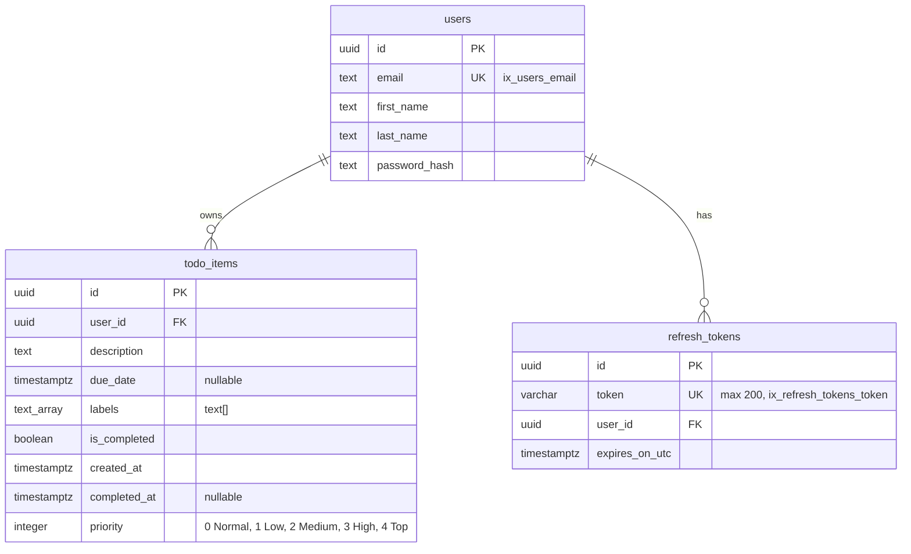

### Observability

`builder.AddServiceDefaults()` (from `Aspire.ServiceDefaults`) sets up:

| Signal | Sources |
|---|---|
| **Logs** | `ILogger` through OpenTelemetry, with formatted messages and **scopes**. The scopes carry `CorrelationId` and the decorator's `Error` payload. |
| **Traces** | ASP.NET Core, HttpClient, EF Core, Npgsql, and an `ActivitySource` named after the application |
| **Metrics** | ASP.NET Core, HttpClient, .NET runtime, Npgsql |
| **Exporter** | OTLP, enabled automatically when `OTEL_EXPORTER_OTLP_ENDPOINT` is set (the AppHost sets it) |
| **Resilience** | `AddStandardResilienceHandler()` on every `HttpClient` (retry, timeout, circuit breaker) |
| **Discovery** | Aspire service discovery on every `HttpClient` |

Send a `CorrelationId` request header to tag your logs with it. Otherwise ASP.NET Core's
`TraceIdentifier` is used.

---

## API reference

| Method | Route | Auth | Notes |
|---|---|---|---|
| `POST` | `/users/register` | anonymous | `authentication` rate-limit policy. Returns the new user id. |
| `POST` | `/users/login` | anonymous | `authentication` rate-limit policy. Returns `{ accessToken, refreshToken }`. |
| `POST` | `/users/refresh-token` | anonymous | `authentication` rate-limit policy. Rotates the refresh token. |
| `GET` | `/users/{userId}` | `users:access` permission | Callers can read only their own user. |
| `GET` | `/todos?userId=&search=&sortColumn=&sortOrder=&page=&pageSize=` | bearer | Returns `PagedList<TodoResponse>`. `sortColumn`: `description`, `dueDate`, `priority`, or `createdAt` (default). `sortOrder`: `asc` or `desc`. Defaults: `page=1`, `pageSize=10`. |
| `GET` | `/todos/{id}` | bearer | Cached in HybridCache. |
| `POST` | `/todos` | bearer | Idempotency via `Idempotency-Key`. Body: `userId, description, dueDate?, labels[], priority`. |
| `PUT` | `/todos/{id}` | bearer | Updates the description. Invalidates the cache entry. |
| `PUT` | `/todos/{id}/complete` | bearer | Returns 400 `TodoItems.AlreadyCompleted` if the item is already done. |
| `DELETE` | `/todos/{id}` | bearer | Invalidates the cache entry. |
| `GET` | `/health` | anonymous | JSON health report (self + PostgreSQL), in HealthChecks UI format. |
| `GET` | `/alive` | anonymous | Liveness check. **Development only.** |
| `GET` | `/openapi/v1.json`, `/scalar/v1` | anonymous | OpenAPI document and Scalar UI. **Development only.** |

All error responses are `application/problem+json`.

---

## Configuration

### Web.Api settings

Settings are read from `appsettings.json`, then `appsettings.{Environment}.json`, then user
secrets (Development), then environment variables (`Section__Key`).

| Key | Default (`appsettings.json`) | Development value | Purpose |
|---|---|---|---|
| `ConnectionStrings:Database` | `""` | `Host=postgres;...` (Aspire **overrides** this through `ConnectionStrings__Database`) | PostgreSQL connection for EF Core and the health check |
| `Jwt:Secret` | `""` | sample value | HS256 signing key. Use **at least 32 bytes**. Keep it in user secrets or a vault, never in git. |
| `Jwt:Issuer` | `""` | `clean-architecture` | `iss` claim, issued and validated |
| `Jwt:Audience` | `""` | `developers` | `aud` claim, issued and validated |
| `Jwt:ExpirationInMinutes` | `0` | `60` | Access token lifetime |
| `Cors:AllowedOrigins` | `[]` | — | Origins allowed by the default CORS policy (credentials allowed) |
| `RateLimiting:Global:PermitLimit` | `100` | — | Requests per window, per user name or client IP |
| `RateLimiting:Global:WindowInSeconds` | `60` | — | Global fixed-window length |
| `RateLimiting:Authentication:PermitLimit` | `10` | — | Requests per window on the register, login, and refresh endpoints |
| `RateLimiting:Authentication:WindowInSeconds` | `60` | — | Auth fixed-window length |
| `OTEL_EXPORTER_OTLP_ENDPOINT` | *(unset)* | set by Aspire | Enables the OTLP exporter |
| `AllowedHosts` | `*` | — | ASP.NET Core host filtering |

Set production secrets with user secrets or environment variables:

```bash
dotnet user-secrets --project src/Web.Api set "Jwt:Secret" "<a-long-random-value>"
# or
export Jwt__Secret="<a-long-random-value>"
export ConnectionStrings__Database="Host=...;Database=...;Username=...;Password=..."
```

> `appsettings.Development.json` also has a `Serilog` section (Console + Seq). Serilog is not
> referenced by the project, so the section has no effect. Logging goes through OpenTelemetry to
> the Aspire dashboard.

### Aspire AppHost

| Setting | Value | Where |
|---|---|---|
| PostgreSQL resource name | `database` | `AddPostgres("database")` |
| Image | `postgres:17` | `.WithImage(...)` |
| Data volume | `<repo>/.containers/db` → `/var/lib/postgresql/data` | `.WithBindMount(...)` |
| Database name | `clean-architecture` | `.AddDatabase(...)` |
| API resource name | `web-api` | `AddProject<Projects.Web_Api>(...)` |
| Startup ordering | the API waits for a healthy database | `.WaitFor(database)` |
| AppHost logging | `Default=Information`, `Microsoft.AspNetCore=Warning`, `Aspire.Hosting.Dcp=Warning` | `src/Aspire.AppHost/appsettings.json` |

Delete `.containers/db` to reset the local database.

### Launch profiles and ports

| Project | Profile | URLs | Extra |
|---|---|---|---|
| **Aspire.AppHost** | `https` | Dashboard `https://localhost:17168` (and `http://localhost:15145`) | OTLP `https://localhost:21034`, resource service `https://localhost:22017` |
| **Aspire.AppHost** | `http` | Dashboard `http://localhost:15145` | OTLP `http://localhost:19291`, resource service `http://localhost:20183` |
| **Web.Api** | `https` | `https://localhost:5001`, `http://localhost:5000` | opens `/scalar/v1` |
| **Web.Api** | `http` | `http://localhost:5000` | opens `/scalar/v1` |
| **Web.Api** | `Docker` | container ports `5000`/`5001` | opens `/scalar/v1` |

### Build settings (`Directory.Build.props`)

Applied to **every** project:

| Property | Value | Why |
|---|---|---|
| `TargetFramework` | `net10.0` | Single target framework for the whole solution |
| `ImplicitUsings` / `Nullable` | `enable` | Modern C# defaults |
| `AnalysisLevel` / `AnalysisMode` | `latest` / `All` | Every .NET analyzer rule on |
| `TreatWarningsAsErrors` | `true` | Warnings fail the build |
| `CodeAnalysisTreatWarningsAsErrors` | `true` | Analyzer warnings fail the build too |
| `EnforceCodeStyleInBuild` | `true` | `.editorconfig` style is checked during `dotnet build` |
| `NoWarn` | `NU1608` | Ignores a known package-version-constraint warning |
| `Authors` / `Company` / `Copyright` | **Ramazan Abdullah** | Assembly and package metadata |
| `Product` | Clean Architecture Template (.NET Aspire) | Assembly metadata |
| `SonarAnalyzer.CSharp` | package reference | Extra static analysis rules |

Because analysis is strict, prefer collection expressions (`[.. x]`), `ToUpperInvariant`, `sealed`
classes, and explicit types, as the existing code does.

### Central package management (`Directory.Packages.props`)

All NuGet versions are kept in one file (`ManagePackageVersionsCentrally=true`), so `.csproj`
files list package names without versions. Main packages:

| Group | Packages |
|---|---|
| Aspire | `Aspire.Hosting.AppHost` 13.4.6, `Aspire.Hosting.PostgreSQL` 13.4.6 |
| Application | `Scrutor` 7.0.0, `FluentValidation.DependencyInjectionExtensions` 12.1.1, `Microsoft.Extensions.Caching.Hybrid` 10.7.0, `Microsoft.EntityFrameworkCore` 10.0.9 |
| Infrastructure | `Npgsql.EntityFrameworkCore.PostgreSQL` 10.0.2, `EFCore.NamingConventions` 10.0.1, `Microsoft.AspNetCore.Authentication.JwtBearer` 10.0.9, `AspNetCore.HealthChecks.NpgSql` 9.0.0 |
| Web.Api | `Microsoft.AspNetCore.OpenApi` 10.0.9, `Scalar.AspNetCore` 2.16.15, `AspNetCore.HealthChecks.UI.Client` 9.0.0 |
| Telemetry | `OpenTelemetry.*` 1.16.x, `Npgsql.OpenTelemetry` 10.0.3, `Microsoft.Extensions.Http.Resilience` 10.7.0 |
| Analysis | `SonarAnalyzer.CSharp` 10.27 |
| Tests | `xunit` 2.9.3, `Shouldly` 4.3.0, `NSubstitute` 5.3.0, `NetArchTest.Rules` 1.3.2, `Testcontainers.PostgreSql` 4.14.0, `Microsoft.AspNetCore.Mvc.Testing` 10.0.9 |

To upgrade a package, change its version here once.

### Docker

`src/Web.Api/Dockerfile` is a multi-stage build (`sdk` → `build` → `publish` → `aspnet`) that exposes
ports `8080`/`8081` and runs as the non-root `$APP_UID` user. Build it from the repo root:

```bash
docker build -f src/Web.Api/Dockerfile -t clean-architecture-api .
```

> Keep the base image tags in step with `TargetFramework`. The solution targets **net10.0**, so the
> `aspnet` and `sdk` images must use the **10.0** tags. `Dockerfile (.NET 8)` is kept as a reference
> for teams that target .NET 8.

For local development you don't need Docker Compose, because the Aspire AppHost replaces it.

### CI/CD

| File | What it does |
|---|---|
| `.github/workflows/build.yml` | On push to `main` (or a manual run): `restore` → `build -c Release` → `test` → `publish`. The `DOTNET_VERSION` env var picks the SDK and must match `TargetFramework` (`10.x`). |
| `.github/dependabot.yml` | Opens daily PRs for NuGet updates. |

---

## Database and migrations

Migrations live in `src/Infrastructure/Database/Migrations/`. The startup project is Web.Api.

```bash
# add a migration
dotnet ef migrations add <Name> --project src/Infrastructure --startup-project src/Web.Api --output-dir Database/Migrations

# apply manually (Development applies migrations at startup automatically)
dotnet ef database update --project src/Infrastructure --startup-project src/Web.Api
```

| Migration | Adds |
|---|---|
| `20240811190111_Create_Database` | `users`, `todo_items` |
| `20260630121611_Add_RefreshTokens` | `refresh_tokens` |

The EF migrations history table is in the `public` schema. Entity configurations
(`IEntityTypeConfiguration<T>` in `Infrastructure/{Feature}/`) are applied automatically through
`ApplyConfigurationsFromAssembly`.

---

## Testing

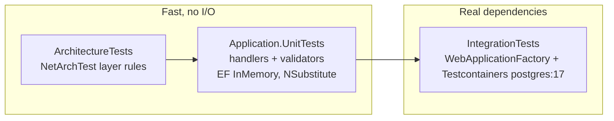

| Project | Scope | Tooling |
|---|---|---|
| `ArchitectureTests` | Checks the dependency rule: Domain does not reference Application, Infrastructure, or Web.Api; Application does not reference Infrastructure or Web.Api; Infrastructure does not reference Web.Api | xUnit, NetArchTest, Shouldly |
| `Application.UnitTests` | Handler logic (success and failure paths, ownership checks, cache use) and validator rules | xUnit, EF Core InMemory (`TestDbContext`), NSubstitute, Shouldly |
| `IntegrationTests` | Full HTTP round-trips: register, login (including a wrong password), refresh (valid and invalid token), create / get / complete / list todos, idempotency-key conflict, and 401 without a token | xUnit, `WebApplicationFactory<Program>`, Testcontainers PostgreSQL, Shouldly |

The integration fixture starts one throwaway `postgres:17` container per test collection, applies
migrations, injects fixed JWT settings, and raises the rate limits so tests are not throttled.

```bash
dotnet test CleanArchitecture.sln                                   # everything
dotnet test tests/ArchitectureTests                                 # just the layer rules
dotnet test --filter "FullyQualifiedName~Todos"                     # one feature
dotnet test CleanArchitecture.sln --collect:"XPlat Code Coverage"   # coverage (coverlet)
```

---

## Extending the template

**Adding a use case by hand** (for example "archive a todo"):

1. `Domain/Todos`: add the state change, a new `TodoItemErrors` entry, and an `...ArchivedDomainEvent` if needed.
2. `Application/Todos/Archive/`: add `ArchiveTodoCommand : ICommand`, an `internal sealed` handler, and an `AbstractValidator<ArchiveTodoCommand>`.
3. `Web.Api/Endpoints/Todos/Archive.cs`: implement `IEndpoint`, inject `ICommandHandler<ArchiveTodoCommand>`, and return `result.Match(Results.NoContent, CustomResults.Problem)`. Add `.WithTags(Tags.Todos).RequireAuthorization()`.
4. If the handler changes cached data, invalidate the cache key.
5. Add unit, validator, and integration tests.

You don't need to register anything: Scrutor discovers the handler, FluentValidation discovers the
validator, and `AddEndpoints` discovers the endpoint.

**Or let Claude Code do it.** The skills in `.claude/skills/` follow these conventions:

| Skill | Example |
|---|---|
| `/add-feature` | `/add-feature archive a todo item` |
| `/add-entity` | `/add-entity Project with a name and owner` |
| `/add-tests` | `/add-tests CompleteTodoCommand` |
| `/add-migration` | `/add-migration Add_Projects` |
| `/add-background-job` | `/add-background-job delete expired refresh tokens hourly` |
| `/bootstrap` | `/bootstrap Acme.Billing` renames the solution and removes the Todos sample |
| `/ca-review` | reviews pending changes against the conventions |

See [.claude/skills/README.md](.claude/skills/README.md) for details.

---

## Author

**Ramazan Abdullah**: design, implementation, and maintenance of this template.

Copyright © Ramazan Abdullah. All rights reserved unless a `LICENSE` file states otherwise.
